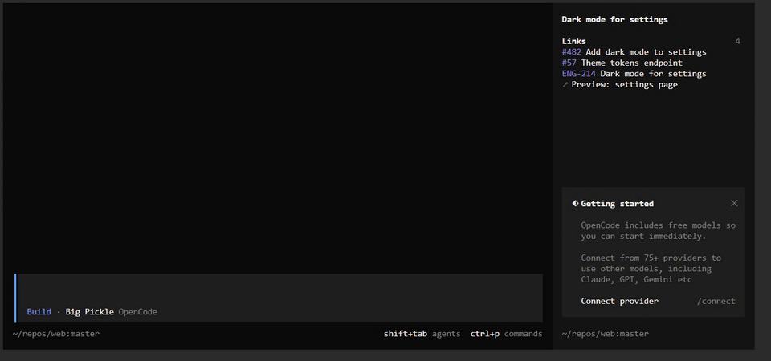

# opencode-pinned-links

[](https://github.com/igorovh/opencode-pinned-links/actions/workflows/ci.yml)
[](https://opencode.ai)
[](LICENSE)

A plugin for the [OpenCode](https://opencode.ai) TUI (v2) that keeps a list of links in the session sidebar. The agent
pins the pull request it opened, the Linear issue it works on or a preview URL, and you open any of them in the
browser with one click.

> Supports OpenCode V2 2.2.5 or newer. V1 is not supported.

<p align="center">
  
</p>

The demo shows the agent pinning a pull request, unpinning a link with its `✕`, unpinning another with `ctrl+d` in
`/links`, pinning a Jira issue with `/pin`, and the menu that opens on a right-click. It uses made-up links; see
[Development](#development) to record it again.

## Features

- **The agent pins links** with the `links_pin` tool: pull requests it opens, issues it works on, deployments. It
  can also list (`links_list`) and remove (`links_unpin`) them. Pinning a URL twice keeps one link and updates its
  title.
- **A `Links` section in the sidebar**, newest first. A click opens the link in your default browser.
- **Short references** for known services, so a row reads `#482 Fix login redirect` instead of a long URL:

  | Service | URL | Shown as |
  |---|---|---|
  | GitHub | `github.com/<owner>/<repo>/pull/482`, `/issues/7` | `#482`, `#7` |
  | Bitbucket | `bitbucket.org/<workspace>/<repo>/pull-requests/57` | `#57` |
  | GitLab | `…/<group>/<repo>/-/merge_requests/12`, `/-/issues/9` | `!12`, `#9` |
  | Linear | `linear.app/<team>/issue/ENG-214/…` | `ENG-214` |
  | Jira | `<site>.atlassian.net/browse/OPS-42` | `OPS-42` |
  | Anything else | | `↗` and the title |

  Without a title, the row shows the repository, the issue slug or the page address.
- **Unpin** with the `✕` that appears on hover, or with a middle click.
- **Right-click a link** to open it, copy its URL, rename it or unpin it.
- **`/links`** lists every link of the session. `Enter` opens the same menu as a right-click, `ctrl+o` opens the
  selected link, `ctrl+d` unpins it. The list also has `Pin a link…` and `Unpin all`.
- **`/pin <url> [title]`** pins a link yourself, for example `/pin https://linear.app/acme/issue/ENG-214 Dark mode`.
- Links belong to the session. Links pinned by a subagent show in the session that started it.

## Requirements

- OpenCode V2 2.2.5 or newer, with the session sidebar shown (`session.sidebar` set to `auto` in `cli.json`, and a
  terminal wide enough for it).
- Windows, macOS or Linux. On Linux, opening links needs `xdg-open` (xdg-utils), `wslview` or `gio`.

## Install

Install a release from GitHub with the OpenCode CLI. Pin the tag: a pinned install is cached and OpenCode can tell
when a newer release exists.

```sh
opencode plugin add github:igorovh/opencode-pinned-links#v0.0.1
```

This adds the plugin to the global `plugins` array in `~/.config/opencode/opencode.jsonc`. The plugin has a server
part (the agent's tools) and a TUI part (the sidebar and commands), so it belongs in `opencode.jsonc`, not in
`cli.json`.

You can also add the entry yourself:

```jsonc
{
  "$schema": "https://opencode.ai/config.json",
  "plugins": ["github:igorovh/opencode-pinned-links#v0.0.1"]
}
```

To remove the plugin:

```sh
opencode plugin remove github:igorovh/opencode-pinned-links#v0.0.1
```

## Keys and commands

| Where | Key or command | Action |
|---|---|---|
| Sidebar | click | Open the link in the browser |
| Sidebar | `✕` on hover, middle click | Unpin the link |
| Sidebar | right-click | Open, copy the URL, rename or unpin |
| Sidebar | click `Links` | Same as `/links` |
| Prompt | `/links` | List the session's links |
| `/links` | `Enter` / `ctrl+o` / `ctrl+d` | Link menu / open / unpin |
| Prompt | `/pin <url> [title]` | Pin a link; without a URL it asks for one |

Both commands are also in the command palette (`ctrl+p`) under `Links`. Their IDs are `pinned-links.list` and
`pinned-links.pin`; bind them under `keybinds` in `cli.json`.

## Options

Options go on the plugin entry in `opencode.jsonc`:

```jsonc
{
  "plugins": [
    {
      "package": "github:igorovh/opencode-pinned-links#v0.0.1",
      "options": { "remind": false }
    }
  ]
}
```

- `remind`: adds one short paragraph to the agent's system instructions asking it to pin pull requests, issues and
  deployments it works on. Default `true`. Set it to `false` and the agent pins links only when you ask or when it
  decides to from the tool description.
- `dir`: where links are saved. Default `~/.local/share/opencode/pinned-links` (or `$XDG_DATA_HOME/opencode/...`).
  `~` is expanded; a relative path is read from your home directory.

## How it works

- The server part adds the `links_pin`, `links_unpin` and `links_list` tools and saves each session's links in one
  JSON file named after the session. It tells the TUI about every change over the plugin's RPC, so the sidebar updates
  at once.
- The TUI part reads links over the same RPC, so it also works with a remote server. Links open on the machine that
  runs the TUI.
- Only `http` and `https` links are accepted. A link opens with `explorer.exe` on Windows, `open` on macOS and
  `xdg-open` on Linux, without a shell, so a link cannot start another program.
- The plugin makes no network requests.

The plugin ships compiled JavaScript in `dist/`, because OpenCode compiles Solid JSX only for plugins outside
`node_modules` ([anomalyco/opencode#39986](https://github.com/anomalyco/opencode/issues/39986)). `dist/` imports only
the modules OpenCode shares with plugins (`@opencode/plugin`, `@opentui/core`, `@opentui/solid`, `solid-js`).

## Development

Requires [Bun](https://bun.sh).

```sh
git clone https://github.com/igorovh/opencode-pinned-links.git
cd opencode-pinned-links
bun install
bun run typecheck
bun test
```

The sources are in `src/`, but OpenCode loads `dist/`. Run `bun run compile` after a change and commit `dist/` with
the sources; CI fails when they differ.

To record the real OpenCode TUI, run `bun run record` ([opencode-tui-recorder](https://github.com/igorovh/opencode-tui-recorder),
set up in `recorder.config.ts`). It needs `opencode` (V2), `ttyd` and `ffmpeg` on `PATH` (or
`OPENCODE_BIN` and `TTYD_BIN`) and Playwright's Chromium. It starts its own server in a temporary home, pins sample
links and opens the session. The README demo is recorded with:

```sh
bun run record -- --out docs/demo.gif --steps docs/demo.steps
```

An `--out` ending in `.png` saves a screenshot instead. Run `bun run record` without steps to see the step list.

To run your checkout instead of the published plugin, put its path in `plugins` and keep the compiler running:

```jsonc
{
  "plugins": ["/path/to/opencode-pinned-links"]
}
```

```sh
bun run compile --watch
```

## License

[MIT](LICENSE)
